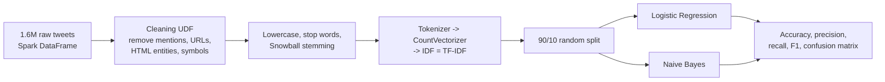
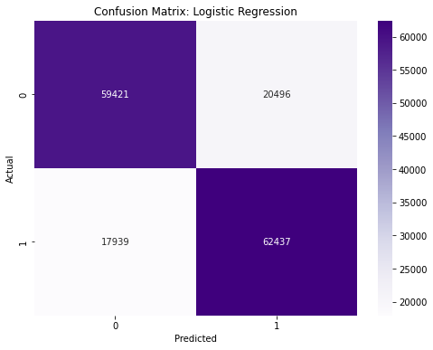
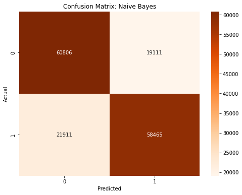

# Large-Scale Tweet Sentiment Analysis with PySpark

Classifying **1.6 million tweets** as positive or negative with a distributed NLP pipeline in **Apache Spark** on Databricks, comparing Logistic Regression and Naive Bayes.


## Highlights

- **Big-data NLP pipeline:** text cleaning, tokenisation, stop-word removal, stemming and TF-IDF features computed in Spark on 1.6M tweets.
- **Two Spark MLlib classifiers** trained on 90% of the data and evaluated on **160,293 held-out tweets**.
- **Logistic Regression is the stronger model: 76.0% accuracy and 0.765 F1**, against 74.4% and 0.740 for Naive Bayes.

## Problem

Brands, researchers and public institutions track opinion on social media at a scale no human team can read. Tweets are short, informal and full of slang, mentions and links, so the text must be cleaned before a model can learn from it. The data volume also calls for distributed processing rather than a single-machine workflow.

## Data

- **[Sentiment140](https://www.kaggle.com/datasets/kazanova/sentiment140):** 1,600,000 English tweets labelled negative (0) or positive (4), balanced between the two classes.
- Only the label and tweet text are used. Labels are mapped to 0/1.
- The dataset (about 230 MB) is not included in this repository. Download it from the link above.

## Approach



- **Text cleaning:** a Spark UDF removes `@mentions`, URLs, HTML entities and non-alphanumeric characters, lowercases the text, drops English stop words (NLTK) and applies Snowball stemming.
- **Features:** Spark ML `Tokenizer` → `CountVectorizer` → `IDF`, producing sparse TF-IDF vectors.
- **Models:** Spark MLlib `LogisticRegression` and `NaiveBayes`, trained on the same 90/10 split (fixed seed).

## Results

Held-out test set: 160,293 tweets.

| Model | Accuracy | Precision | Recall | F1 |
|---|---:|---:|---:|---:|
| **Logistic Regression** | **0.760** | 0.753 | **0.777** | **0.765** |
| Naive Bayes | 0.744 | **0.754** | 0.727 | 0.740 |

Precision, recall and F1 are reported for the positive class.

| Logistic Regression | Naive Bayes |
|---|---|
|  |  |

## Key takeaways

- **Logistic Regression generalises better** and makes fewer errors overall (38,435 vs. 41,022 misclassified tweets). It recovers far more positive tweets, while Naive Bayes is slightly more conservative.
- **Both models plateau around 75%,** which is typical for bag-of-words features on tweets: they can't capture sarcasm, negation ("not good") or word order.
- **Possible next steps:** n-gram features, hyperparameter tuning with Spark's `CrossValidator`, and a fine-tuned transformer model (such as a Twitter-specific BERT) for comparison.

## Repository structure

```
twitter-sentiment-pyspark/
├── notebooks/
│   └── sentiment140_pyspark.ipynb              # notebook with saved outputs (exported from Databricks)
├── figures/                                    # figures used in this README
├── docs/
│   └── report_summary.md                       # summary of the project report
└── requirements.txt
```

## How to run

**On Databricks (as originally built)**
1. Upload the Sentiment140 CSV to DBFS so that it matches `data_path` in the notebook: `/FileStore/tables/training_1600000_processed_noemoticon.csv`.
2. Import `notebooks/sentiment140_pyspark.ipynb` into your workspace (Workspace → Import) and run all cells.

**Locally**
```bash
pip install -r requirements.txt
```
Then open the notebook and change `data_path` to the local CSV location. The full dataset needs several GB of memory, so you can start with a sample.

## Project context

Project for the *Hardware and Software for Big Data* course, MSc Data Science, University of Naples Federico II. A summary of the project report is in [`docs/report_summary.md`](docs/report_summary.md).
